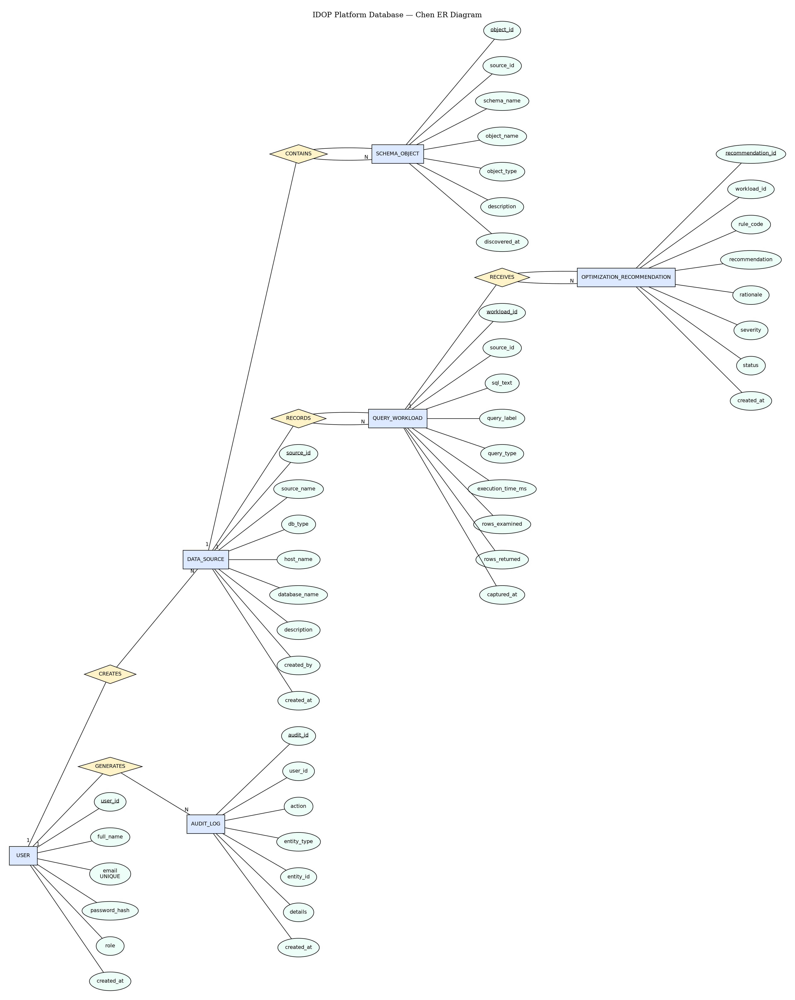
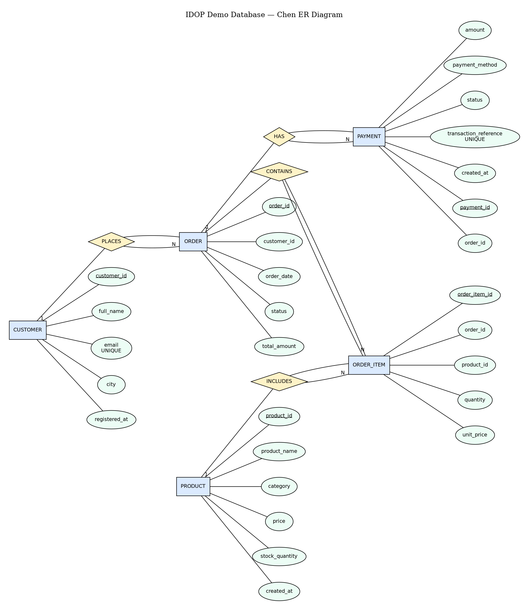

# Intelligent Database Discovery and Optimization Platform

A database management platform that combines relational metadata storage, vector-based SQL workload discovery, and deterministic, explainable query optimization recommendations.

**Project status:** Presentation-ready development freeze.

## Overview

Database workloads can become difficult to understand and optimize as applications grow. This project aims to help users discover relevant SQL workloads using natural-language queries, inspect stored optimization recommendations, and examine MySQL execution plans.

The platform combines MySQL for structured data and Qdrant for vector similarity search. Optimization suggestions are generated using deterministic rules rather than an LLM.

## Architecture

```text
User
 |
 v
Python CLI
 |
 +----------------------+
 |                      |
 v                      v
FastEmbed             MySQL
 |                    |
 v                    +-- Platform metadata
Qdrant                +-- Query workloads
 |                    +-- Optimization recommendations
 v                    +-- E-commerce demo data
Ranked workloads               |
                               v
                         MySQL EXPLAIN
                               |
                               v
                      Execution-plan output
```

### Technology stack

- **MySQL 8.4:** Relational storage, metadata, query workloads, recommendations, constraints, indexes, and analytical queries.
- **Qdrant:** Vector database for semantic retrieval of SQL workloads.
- **FastEmbed:** Generates text embeddings for semantic search.
- **Python:** Workload analysis, database access, semantic search, and CLI integration.
- **Docker:** Runs the Qdrant service.
- **Mermaid:** Source format for relational/crow's-foot ER diagrams.
- **Graphviz DOT:** Editable Chen-notation ER source.

## Database Design

The project uses two MySQL databases.

### 1. Platform metadata database — `idop_platform_db`

Contains six tables:

- `users`
- `data_sources`
- `schema_objects`
- `query_workloads`
- `optimization_recommendations`
- `audit_logs`

These tables represent users, registered data sources, discovered schema objects, SQL workloads, recommendations, and audit events.

### 2. E-commerce demo database — `idop_demo_db`

Contains five tables:

- `customers`
- `products`
- `orders`
- `order_items`
- `payments`

This database supplies sample relational data for workload discovery, execution-plan inspection, and analytical reporting.

### ER diagrams
### Platform Metadata ER Diagram


### E-Commerce Demo ER Diagram


The editable Chen-notation source is [docs/demo_chen_erd.dot](docs/demo_chen_erd.dot).
Rectangles represent entities, diamonds represent relationships, ellipses
represent attributes, and edge labels show cardinalities. Render it with
`dot -Tpng docs/demo_chen_erd.dot -o docs/demo_chen_erd.png`.

The platform Chen source is [docs/platform_chen_erd.dot](docs/platform_chen_erd.dot).
Render it with `dot -Tpng docs/platform_chen_erd.dot -o docs/platform_erd.png`.
	
The database diagrams and their editable Mermaid sources are available in `docs/`:

- `platform_erd.png` — platform metadata schema.
- `platform_erd.md` — editable platform ER diagram source.
- `demo_erd.png` — e-commerce demo schema.
- `demo_erd.md` — editable demo ER diagram source.
- `demo_chen_erd.dot` — editable Chen-notation demo ER diagram source.
- `platform_chen_erd.dot` — editable Chen-notation platform ER diagram source.

## Implemented Features

- Natural-language semantic search over stored SQL workloads.
- Vector indexing and retrieval using Qdrant.
- Deterministic SQL pattern analysis for `SELECT *`, filters, joins, and `GROUP BY`.
- Storage and retrieval of optimization recommendations in MySQL.
- Recommendation metadata including rule code, severity, rationale, and status.
- MySQL `EXPLAIN` integration in the CLI workflow.
- Analytical SQL reports using joins, aggregation, grouping, and subqueries.
- Relational constraints and indexes in the demo schema.
- Views, triggers, stored procedures, stored functions, transactions, and MySQL FULLTEXT search; see [docs/advanced_sql_features.md](docs/advanced_sql_features.md).

## Optimization Approach

The analyzer uses predefined rules to identify query patterns worth reviewing. Suggestions include checking index support, reviewing unnecessary column selection, inspecting join access paths, and examining grouping operations.

Recommendations are **candidates for investigation**, not guarantees of improved performance. The platform uses `EXPLAIN` to inspect the optimizer's plan. Actual performance improvements require controlled measurements and validation.

## Project Structure

```text
DBMS-mini-project/
├── docs/
│   ├── platform_erd.md
│   ├── platform_erd.png
│   ├── demo_erd.md
│   └── demo_erd.png
├── sql/
│   ├── demo/
│   │   ├── schema.sql
│   │   └── seed.sql
│   └── platform/
│       ├── schema.sql
│       └── seed.sql
├── src/
│   ├── analyzer.py
│   ├── db.py
│   ├── demo.py
│   ├── process_workloads.py
│   └── semantic_search.py
├── tests/
├── vector/
├── .gitignore
└── README.md
```

## Setup

### Prerequisites

- Python with `pip`
- MySQL 8.4 or compatible version
- Docker Desktop
- Git

### 1. Clone and enter the repository

```bash
git clone https://github.com/PiyushShiv26/DBMS-mini-project
cd DBMS-mini-project
```


### 2. Create a Python environment

```bash
python3 -m venv .venv
source .venv/bin/activate
python -m pip install --upgrade pip
```

Install the project's Python dependencies:

```bash
python -m pip install -r requirements.txt
```

The web backend is exposed by `backend.main:app` and is designed for the Next.js frontend.

### 3. Configure MySQL

Create the databases and load the schema and seed files in the appropriate order:

1. `sql/demo/schema.sql`
2. `sql/demo/seed.sql`
3. `sql/platform/schema.sql`
4. `sql/platform/seed.sql`

The SQL files expect the databases `idop_demo_db` and `idop_platform_db` to exist.

### 4. Configure database credentials

Copy `.env.example` to `.env` and fill in the local values. The backend loads `.env` automatically with `python-dotenv`; do not commit the real secret file.

```bash
cp .env.example .env
# Edit .env and set DB_PASSWORD, API_TOKEN_SECRET, and ADMIN_PROVISIONING_KEY.
```

Use an appropriately privileged database account for your environment.

### 5. Start Qdrant

```bash
docker run -d \
  --name idop-qdrant \
  -p 6333:6333 \
  -p 6334:6334 \
  -v idop_qdrant_data:/qdrant/storage \
  qdrant/qdrant
```

If the container already exists, start it with:

```bash
docker start idop-qdrant
```

Check the service:

```bash
curl http://localhost:6333/collections
```

### 6. Run the prototype

Start the REST backend:

```bash
uvicorn backend.main:app --reload --port 8000
```

It provides `GET /api/health`, authentication at `/api/auth/register` and
`/api/auth/login`, workload/recommendation endpoints, semantic `/api/search`,
and workload EXPLAIN endpoints. Send the returned token as
`Authorization: Bearer <token>`. Set `CORS_ORIGINS` to the frontend origin if
it is not `http://localhost:3000`.

For local development, also set a stable token secret:

```bash
# These values are loaded automatically from .env.
```

Start the Next.js frontend in a second terminal:

```bash
cd frontend
npm ci
npm run dev
```

The advanced SQL definitions and demonstration commands are documented in
[docs/advanced_sql_features.md](docs/advanced_sql_features.md).

Then run the existing CLI tools as needed:

Index and search the SQL workloads:

```bash
python src/semantic_search.py
```

Process workloads and save rule-based recommendations:

```bash
python src/process_workloads.py
```

Run the integrated CLI workflow:

```bash
python src/demo.py
```

The first embedding-model run may require an internet connection to download model files.

## Current Limitations and Future Work

- Semantic discovery currently operates over a small set of sample workloads.
- Similarity ranking always returns nearest candidates unless additional relevance filtering is implemented.
- The SQL analyzer uses pattern-based rules rather than a complete SQL parser.
- Recommendations require review against the actual schema and execution plan.
- Performance gains have not yet been established through controlled benchmarks.
- A full web interface, broader workload ingestion, automated benchmarking, and more extensive testing remain future work.

## Novelty and Intended Contribution

The project's intended contribution is the combination of semantic SQL workload discovery with deterministic, explainable optimization recommendations and execution-plan inspection.

The design aims to help users locate relevant queries, understand why a query pattern merits investigation, and examine the database optimizer's plan before deciding on changes.

The current implementation is a prototype; its usefulness and performance benefits require further evaluation.

## License

This project is licensed under the [MIT License](LICENSE).
